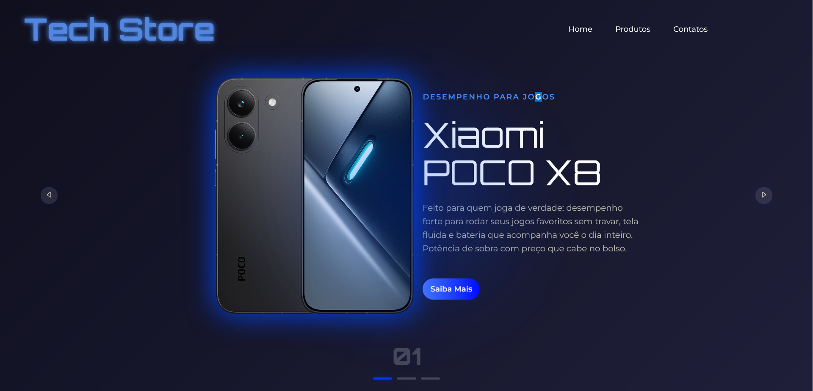

<h1>📱 Tech Shop </h1>

Site de vendas de eletrônicos da Xiaomi, com visual escuro e detalhes em
azul neon. Projeto de estudo de front-end feito para praticar HTML, CSS
e JavaScript construindo algo parecido com uma loja de verdade.

## Produtos em destaque

- Poco X8
- Poco X7
- Xiaomi 15T

Cada produto tem uma descrição curta no card e um botão **Saiba Mais** que
mostra a descrição completa.

## Tecnologias

- HTML5
- CSS3
- JavaScript

## Funcionalidades

- [x] Página com os produtos em destaque
- [x] Tema escuro com destaque em azul neon
- [x] Carrossel de produtos (botões anterior/próximo e indicadores)
- [x] Botão "Saiba Mais" com descrição detalhada 
- [x] Layout responsivo para celular

## Como rodar

1. Clone o repositório:
   `git clone https://github.com/SEU-USUARIO/Tech-shop-site.git`
2. Abra o arquivo `index.html` no navegador.

## O que aprendi

Neste projeto estou praticando a estrutura de uma página com HTML semântico,
estilização com CSS e a lógica do carrossel em JavaScript, que troca o
produto ativo e atualiza os indicadores. 

## Status

Em desenvolvimento. Projeto criado em outubro de 2026 como parte de um
desafio pessoal de programar todos os dias durante 3 meses.

## Autor

Gabriel - [GitHub](https://github.com/GabrielRachel)
